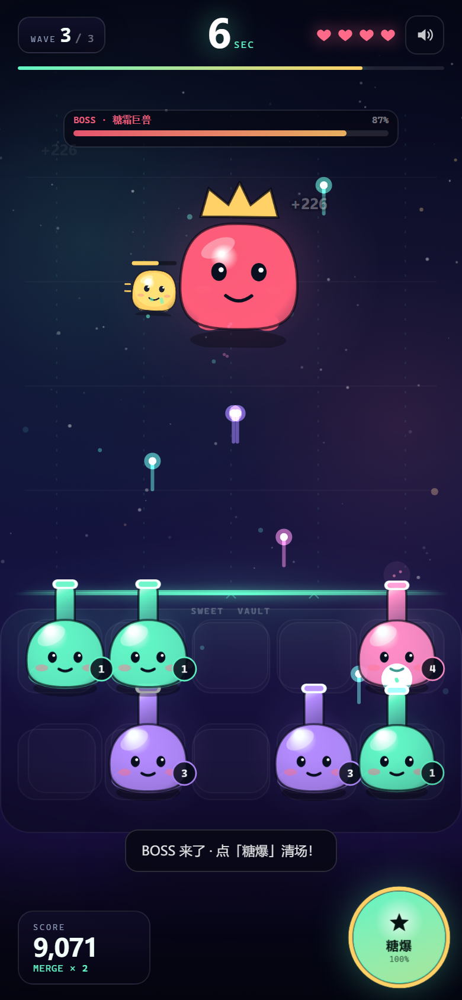

# 果冻防线 · Jelly Guard

> 一个为「AI 试玩 / H5 游戏开发」岗位准备的 30 秒 H5 试玩广告 Demo。  
> 不只是小游戏：包含 AI 变体生产、单文件构建、埋点、自动化 QA 和一套可复用的试玩 SOP。

**在线作品集**：https://1664164662.github.io/jelly-guard/  
**在线试玩**：https://1664164662.github.io/jelly-guard/play/  
**源码**：https://github.com/1664164662/jelly-guard



**当前构建**：`v1.0.0+7d102d65` ｜ 单文件 **119.6 KB** ｜ gzip **31.0 KB** ｜ 运行时依赖 **0** ｜ 外部请求 **0** ｜ 冒烟测试 **5/5**

---

## 先看什么

| 入口 | 说明 |
| --- | --- |
| `index.html` | 作品集落地页：项目背景、30 秒节奏、AI 工作流、性能与 QA |
| `play/index.html` | 可直接玩的试玩页，支持变体 / debug / seed 参数 |
| `dist/play/index.html` | 构建后的单文件试玩（可直接投放 / 塞 iframe） |
| `dist/build-report.json` | 尺寸、gzip、SHA-256、检查项 |
| [`docs/罗迪-果冻防线-项目一页纸.pdf`](docs/罗迪-果冻防线-项目一页纸.pdf) | 可直接发给 HR 的项目一页纸 |
| `docs/` | SOP、案例、AI 流程、QA 清单、项目一页纸 |

> 项目一页纸里的作品集链接是 `[部署后填写]`，发出去前替换成真实链接。简历、面试稿等求职材料不放在公开仓库。

本地启动：

```bash
npm run dev
# http://127.0.0.1:4173/
# http://127.0.0.1:4173/play/?debug=1
```

> 需要 Node.js 20+。项目零运行时依赖，不需要 `npm install`。

---

## 这是什么

《果冻防线》是一个**虚构手游的试玩广告**：

- 玩家拖动同色果冻炮台，两两合成升级；
- 炮台自动攻击，守住 30 秒；
- 三个波次逐步加压，6.3 / 12.3 / 18.3 秒空投新炮台；
- 23 秒 Boss 带护卫入场；
- 攒满「糖爆」可清场；
- 30 秒后进入 End Card，展示分数并提供下载 CTA。

它同时是一个**工程作品**：

- Vanilla JS + Canvas 2D，无框架、无图片、无字体、无 CDN；
- 单 HTML 文件构建，可直接投放或放进 iframe；
- 3 套可切换主题（薄荷 / 莓果 / 日落）；
- MRAID / Google ExitApi / TikTok `playableSDK` 下载桥预留；
- 全链路事件通过 `postMessage` 回传，作品集页实时显示；
- Chrome CDP 自动化冒烟测试覆盖开始、合成、糖爆、胜负重开、CTA；
- AI 变体生成器把 LLM 的输出限制在 JSON schema 内，失败自动回退。

## 这不是什么

- **不是冰川网络的官方项目**，和冰川网络没有隶属关系；
- **没有真实投放数据**，所以不写 CTR / IPM / CVR 的“战绩”；
- End Card 里的应用名、评分、下载按钮都是虚构演示素材；
- AI 变体目前包含一条**离线 fallback 生成记录**；接上 API key 后才是真实 LLM 输出。项目文档里明确区分这两种模式。

---

## 30 秒体验

| 时间 | 发生什么 | 设计目的 |
| --- | --- | --- |
| 0–3s | 吉祥物 + 一句话卖点 + 开始按钮 | 不加载、不解释，先给情绪 |
| 3–10s | 虚线路径 + 同色高亮 + 第一次合成 | 一个动作学会核心规则 |
| 6.2s | 若无合成，自动完成第一次 | 保证体验不断线 |
| 10–22s | 第 2/3 波、三连怪、空投补给 | 压力与成长交替 |
| 23–30s | Boss + 护卫、糖爆、结算 | 把情绪推到最高点 |
| End | 分数 / 合成数 / 击杀数 + 下载 CTA | 成就感转行动 |

---

## 快速开始

```bash
# 生成变体配置 + 启动本地静态服务器
npm run dev

# 构建单文件试玩 + 作品集静态站点
npm run build

# 静态验收（尺寸 / gzip / 外部引用 / 关键能力）
npm run qa

# 5 项 Chrome CDP 冒烟测试（自动启动 server + headless Chrome）
npm test

# AI 变体（需 API key；无 key 自动走 fallback）
export DEEPSEEK_API_KEY=sk-...
npm run ai:variant -- --brief "夏日柠檬气泡，清爽、轻快" --id lemon

# 不调用 API，只验证流水线
npm run ai:variant -- --brief "夏日柠檬气泡" --id lemon --offline --force
```

如果 Chrome 不在默认路径：

```bash
CHROME_PATH="/path/to/chrome" npm test
```

### URL 参数

| 参数 | 作用 |
| --- | --- |
| `?variant=mint\|berry\|sunset` | 切换主题 / 文案变体 |
| `?debug=1` | 显示 FPS / 实体数 / DPR / 质量等级 |
| `?seed=7` | 固定波次随机种子，方便复现 |
| `?quality=high` | 关闭自动降级，方便性能测试 |
| `?autostart=1` | 跳过开始按钮，直接进入游戏 |
| `?screen=end` / `?screen=lose` | 直接展示结算页，方便截图 |

---

## 项目结构

```text
jelly-guard/
├─ index.html                  作品集落地页
├─ play/index.html             试玩页（开发态）
├─ src/
│  ├─ game.js                  Canvas 游戏引擎 / 状态机 / UI
│  ├─ game.css                 试玩 UI
│  ├─ landing.css / landing.js 作品集页 + iframe 实时埋点
│  ├─ generated-variants.js    由 variants/*.json 自动生成
├─ variants/                   主题 / 文案 / 难度配置
├─ ai/
│  ├─ prompts/                 概念、变体、QA、文案提示词
│  └─ runs/                    每次 AI 生成的 prompt / response 留档
├─ tools/
│  ├─ gen-variants.mjs        JSON 校验 + 生成浏览器配置
│  ├─ ai-variant.mjs           schema 约束的 AI 变体生成器
│  ├─ build.mjs               单文件构建 + 尺寸 / hash 报告
│  ├─ qa.mjs                  构建产物验收
│  ├─ serve.mjs               零依赖静态服务器
│  └─ cdp.mjs                 Chrome DevTools Protocol 客户端
├─ tests/smoke.mjs             5 项浏览器冒烟测试
├─ docs/                       SOP / 案例 / 面试 / 简历材料
└─ dist/                       构建产物
```

---

## 实现笔记

### 1. 玩法状态机

`start → playing → win / lose`，结算时停止 Canvas 渲染并切换到静态背景，避免 End Card 的 `backdrop-filter` 叠在持续重绘的 Canvas 上。

### 2. 合成与索敌

- 5 列 × 2 行共 10 个槽位，初始 5 座炮台；
- 同色可合成，最高 Lv.5；不同色交换位置；
- 索敌**同轨优先，跨轨兜底**：多炮台时保持列的策略性，合成到只剩一座时也不会直接漏穿；
- 6.2 秒仍未完成第一次合成时自动兜底，保证试玩不断线。

### 3. 性能

- 精灵、背景、光晕全部离屏 Canvas 预渲染；
- 粒子有数量上限并按质量档位缩放；
- 固定 1/60s 时间步，渲染帧率与模拟解耦；
- DPR 上限 2，连续低帧率自动降到 1.5；
- 页面不可见时暂停并重置时钟；
- 结束页停止 Canvas 重绘。

### 4. 埋点

事件包括：

`ad_impression`、`ad_start`、`tutorial_complete`、`merge`、`turret_pick`、`reposition`、`supply_drop`、`sugar_burst`、`boss_spawn`、`boss_kill`、`enemy_leak`、`ad_complete`、`ad_fail`、`end_card_view`、`cta_click`、`store_open`、`replay`、`perf`、`quality_adapt`。

试玩页通过 `postMessage` 把事件发给父页面；作品集页的 LIVE TELEMETRY 面板实时显示，同时展示 FPS。

### 5. 下载桥

End Card 的 CTA 会依次检测：

1. `mraid.open(url)`
2. `ExitApi.exit()`
3. `playableSDK.openAppStore()`
4. 都没有则只显示模拟 toast，不真实跳转

这样同一份构建可以进 MRAID 环境、Google Ads、TikTok 或普通 iframe。

### 6. AI 变体流水线

```text
brief → LLM JSON → schema 校验 → 失败回退 → variants/<id>.json
      → src/generated-variants.js → 单文件构建 → 尺寸 / 外部请求检查
```

- LLM 只输出主题、文案、难度参数，不写游戏逻辑；
- 校验颜色格式、文案长度、`bossAt < duration` 等硬约束；
- API 不可用时使用本地 recipe，构建不中断；
- 每次运行把 prompt / raw / normalized 写入 `ai/runs/`；
- 示例「日落汽水」变体由离线 fallback 生成，运行记录可查。

---

## 实测与验收

本地测试环境：Chrome 155 Headless，390 × 844，DPR 2，Windows。

| 项目 | 结果 |
| --- | --- |
| 单文件 raw | 约 119.6 KB（预算 ≤ 150 KB） |
| 单文件 gzip | 约 31.0 KB（预算 ≤ 50 KB） |
| 外部请求 | 0 |
| 桌面 headless FPS | 60（峰值特效约 48–60） |
| 自动化冒烟 | 5 / 5 |
| 静态验收 | 18 / 18 |

> 这些是工程指标，不是投放效果。真实投放需要看平台、素材、受众和出价。

---

## 文档

- [`docs/SOP.md`](docs/SOP.md) — 试玩广告生产 SOP
- [`docs/CASE-STUDY.md`](docs/CASE-STUDY.md) — 完整案例拆解
- [`docs/AI-WORKFLOW.md`](docs/AI-WORKFLOW.md) — AI 变体流水线
- [`docs/QA-CHECKLIST.md`](docs/QA-CHECKLIST.md) — 发版检查清单
- [`docs/PROJECT-ONE-PAGER.md`](docs/PROJECT-ONE-PAGER.md) — 一页纸项目说明
- [`docs/罗迪-果冻防线-项目一页纸.pdf`](docs/罗迪-果冻防线-项目一页纸.pdf) — 可直接发送的 PDF

---

## 面试时怎么讲（一句话版）

> 我按“30 秒内让玩家完成一次合成、一次清场、一次下载决策”的目标做了这个试玩，并把 AI 变体、单文件构建、埋点和自动化测试接进了同一条流水线。它现在能跑、能测、能复现。

不要写“真实投放 CTR 提升”，这个项目没有投放数据。

---

## License

MIT。仅作为个人求职作品，不包含任何第三方游戏素材或商标。
